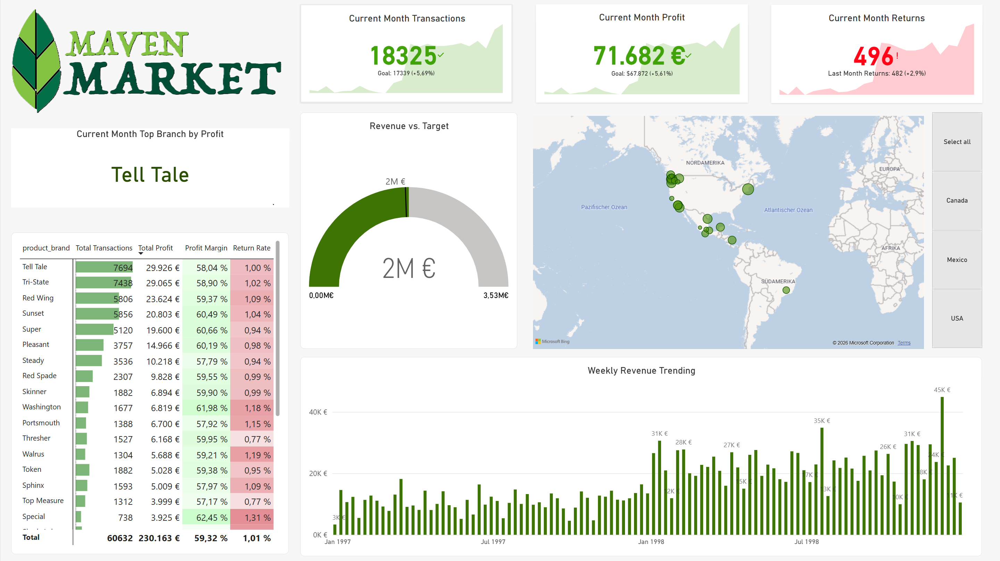
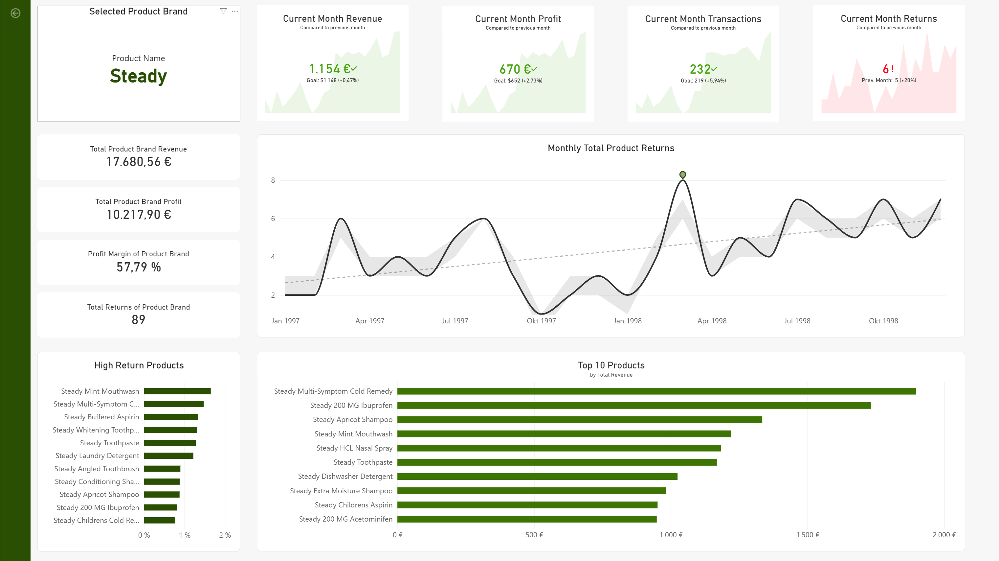
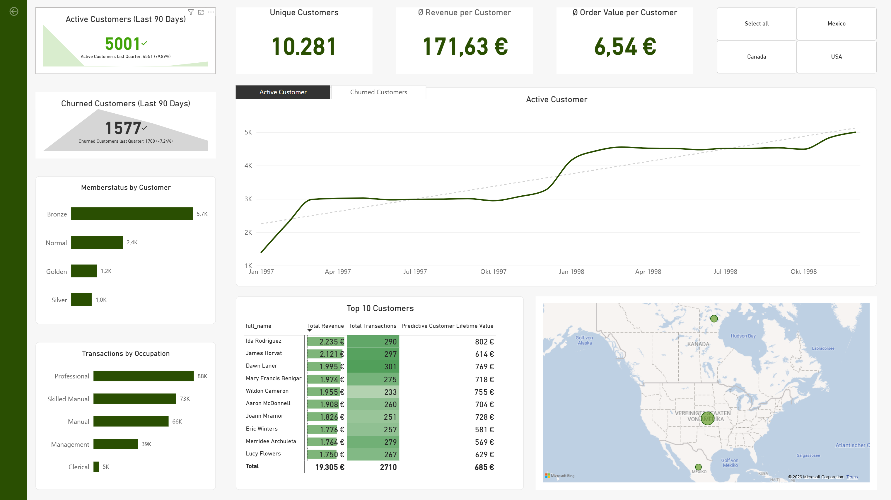

# Maven Market – Business Intelligence & Analytics Portfolio

> **Ein privates Portfolio-Projekt zur Analyse von Unternehmensleistung, Produktgruppen und Kundenverhalten eines globalen Einzelhändlers.**
>
> ---

## Projektüberblick & Zielsetzung
Dieses Projekt habe ich für mein persönlichen Portfolios entwickelt, um einen vollständigen **Data Analytics Workflow** von der Datenaufbereitung bis zum interaktiven Dashboard-Design zu demonstrieren. 

Das Hauptziel ist es, Geschäftsdaten des Einzelhändlers *Maven Market* nutzbar zu machen, operative KPIs zu überwachen und strategische Erkenntnisse für Vertrieb, Produktmanagement und Kundenbindung zu liefern.

### Tech Stack & Key Skills
**Business Intelligence:** Microsoft Power BI Desktop
**Datenaufbereitung:** Power Query (ETL-Prozess: Datenimport, Bereinigung & Datentyp-Transformationen)
**Datenmodellierung:** Erweitertes Sternschema / Schneeflockenschema (Snowflake Schema) zur Optimierung der Performance
**Analytics:** DAX (Time Intelligence, KPI Target-Vergleiche, Customer Lifetime Value)
**UI/UX Design:** Konsistentes Branding, barrierearme Farbpalette (Grün/Rot-Kontraste), interaktive Filter & Drill-Downs

## Dashboard-Übersicht & Funktionalitäten
Das Dashboard gliedert sich in drei spezialisierte Berichtsseiten für unterschiedliche Stakeholder-Ebenen:

### 1. Topline Performance
**Fokus:** C-Level Übersicht über operative Gesamtkennzahlen und weltweite Leistung.
**Kernfunktionen:**
  * High-Level KPIs für Transaktionen, Gesamtgewinn und Retouren mit Trend-Sparklines.
  * Zielerreichungs-Gauge (**Revenue vs. Target**): Visualisierung des Gesamtumsatzes im Verhältnis zum hinterlegten Zielwert zur schnellen Bewertung der Performance.
  * Globale Vertriebskarte zur visuellen Analyse der Standorte in Nord- und Südamerika.
  * Wöchentlicher Umsatztrend (**Weekly Revenue Trending**) sowie eine Ranking-Tabelle aller Herstellermarken nach Transaktionen, Profit, Marge und Retourenquote.

> 

### 2. Product Brand Detail
**Fokus:** Detaillierte Produkt- und Markenanalyse zur Identifikation von Bestsellern und Problemprodukten.
**Kernfunktionen:**
  * Drill Through Filterung nach spezifischen Herstellern (z. B. *Steady*).
  * Analyse von Umsatz, Gewinn, Profitmarge und Gesamtzahl der Retouren auf Markenebene.
  * Zeitreihen-Analyse für monatliche Produkt-Retouren (**Monthly Total Product Returns**).
  * Gegenüberstellung der Top 10 Produkte nach Umsatz vs. Produkte mit den höchsten Retourenquoten (**High Return Products**).

> 

### 3. Customer Detail
**Fokus:** Analyse der Kundenbasis, Churn-Messung und Identifikation wertvoller Kunden.
**Kernfunktionen:**
  * Tracking aktiver Kunden (letzte 90 Tage) vs. abgewanderter Kunden (**Churned Customers**).
  * Übersicht zu Kundensegmenten (*Memberstatus:* Bronze, Normal, Silver, Golden) und Berufsgruppen (*Occupation*).
  * Entwicklung der aktiven Kunden im Zeitverlauf.
  * **Top 10 Kunden-Ranking** inkl. Transaktionen, Gesamtumsatz und vorhergesagtem *Predictive Customer Lifetime Value (CLV)*.

> 

## Key Business Insights
1. **Retouren-Management:** Durch die Analyse im *Product Brand Detail* lassen sich gezielt Einzelprodukte identifizieren, die trotz hoher Umsätze überproportional viele Retouren verursachen.
2. **Zielgruppenorientiertes Marketing:** Da die Berufsgruppe Professional den größten Teil aller Transaktionen ausmacht, können Marketingbudget und Aktionen exakt auf diese Hauptzielgruppe zugeschnitten werden.
3. **Erfolgreichste Herstellermarke:** Im Topline-Dashboard hebt sich Tell Tale als absolute Spitzenmarke mit dem höchsten Monatsgewinn (29.926 €) hervor, gefolgt von Tri-State. Diese Marken bilden das wirtschaftliche Rückgrat des Sortiments.
